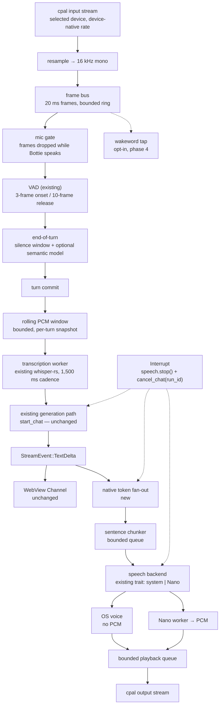
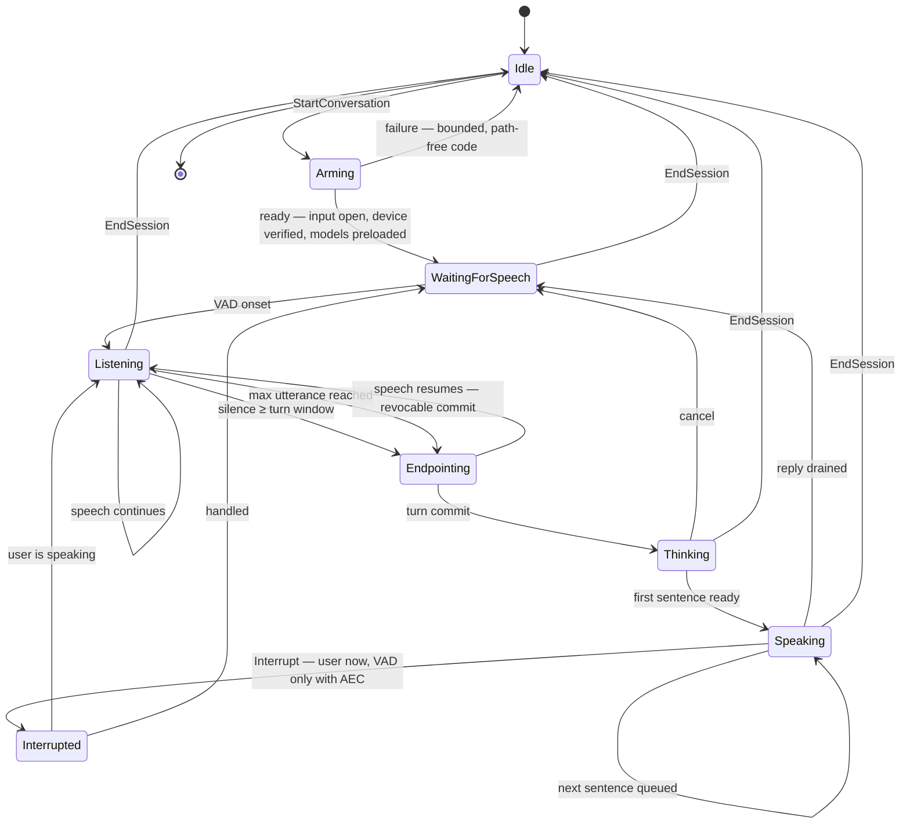

# Voice mode, part: end-to-end pipeline architecture

Scope: how wakeword, capture, endpointing, an arbitrary chat model, streaming TTS, and interruption fit
together in Bottie, given that Rust owns audio natively and the chat model must stay pluggable. This part owns
control flow, duplex audio, AEC placement, cancellation edges, and the latency budget. Model *choice* (which
wakeword, which STT, which TTS) belongs to the sibling parts; this part only fixes the interfaces they plug into.

Everything here is research input. Nothing in this file is wired into Bottie, and no Bottie source, dependency,
build, packaging, or test path reads it.

Web sources checked 2026-11-01; repository facts read from commit `118dea43` (2026-10-31). Speech tooling moves
fast — treat the external numbers as having a shelf life of months, not years.

## 1. Answer first

**Recommendation: ship half-duplex hands-free conversation first, as a Rust-owned turn controller inside the
existing `microphone`/`speech`/`generation` modules, with no new dependencies and no new model downloads.**
One explicit **Start conversation** action opens a bounded listening session; the existing energy VAD plus a
longer, configurable end-of-utterance silence decides the turn; the final transcript enters the *existing*
generation path unchanged; a native sentence-chunker splits the token stream and hands the first sentence to the
*existing* speech backend while the rest of the reply is still generating; barge-in is an explicit user action
that reuses the existing cancellation boundary. That reaches "wear headphones and talk to Bottie" without new
native surface, new weights, or a new trust boundary.

**Runner-up: full-duplex barge-in with in-process acoustic echo cancellation**, which is the real prize and the
only way to speak over Bottie's voice without a keypress. It is *not* a small change: it needs a PCM-streaming
TTS backend (the OS `tts` crate cannot supply the render reference), a duplex audio owner (cpal 0.18.2 has no
duplex API), and a per-platform AEC decision that does not exist yet. It should be phase 3, behind measurements,
not phase 1.

The single most consequential finding: **echo cancellation requires Bottie to own the exact PCM that is being
played.** OS voices go straight from `tts` to the platform's speech engine; Bottie never sees those samples, so
there is no render reference to cancel against. Streaming TTS (today the optional Nano worker; the TTS part owns
the engine choice) and AEC are therefore the same dependency, not two projects.

## 2. Constraints that decide it

The full constraint list is in `CONVENTIONS.md`; these are the ones that actually separate the candidates.

| Constraint | What it excludes here |
| --- | --- |
| Local-only, no cloud speech | Every reference stack's default transports (Daily, LiveKit Cloud, Deepgram Flux endpointing, ElevenLabs TTS). Their *architecture* is still borrowable. |
| MIT-compatible code **and weights** | openWakeWord's pre-trained models are CC-BY-NC-SA 4.0 (`openWakeWord` README, "License") — a non-commercial weight licence, so they fail even though the code is Apache-2.0. Porcupine is proprietary. Any wakeword path needs either self-trained weights or a permissively licensed third party. |
| Rust owns capture, PCM, devices, cancellation; WebView never sees audio or paths | Rules out any design where the WebView drives the audio graph, and rules out a browser-audio or WebRTC-transport pipeline (Pipecat/LiveKit/RealtimeVoiceChat shapes) as the *product* path. |
| Heavy native code goes in supervised sidecars; the Rust process holds credentials | A bundled C++ WebRTC AEC in-process is a trust-boundary change; a pure-Rust AEC is not. This is the decisive AEC fork (§4.2). |
| Bounded resources; always-on microphones need an explicit budget case | Kills "always listening for a wakeword" as a default. Voice mode must be an explicitly armed session, not a background daemon. |
| Builds in CI on macOS arm64/x64, Windows x64, Linux x64 | Kills single-platform AEC shortcuts as *the* answer; each platform's echo path is a qualification item, not a shared code path. |
| Pluggable model | Kills any speech-to-speech design, and forces the voice layer to speak only "transcript in, token stream out". |
| Existing interlock: playback must stop before the mic opens (`stop_before_microphone_capture`) | This is Bottie's current anti-self-hearing guarantee, and it is exactly what hands-free duplex removes. Whatever replaces it must be at least as trustworthy. |

## 3. Candidate table

### 3.1 Reference voice-agent stacks — reusable in-process or server-shaped?

| Candidate | What it is | Licence | In-process in a Tauri app? | What Bottie should borrow | Evidence |
| --- | --- | --- | --- | --- | --- |
| [Pipecat](https://github.com/pipecat-ai/pipecat) | Python asyncio frame pipeline; `Frame` dataclasses, `FrameProcessor` chain, services for VAD/turn/STT/TTS/transport | BSD-2-Clause [unverified — not read] | No. Python asyncio runtime; its transports assume a media server or WebRTC peer. Could only run inside Bottie's existing *Python worker*, which would put the whole conversation inside the least-trusted process | **The frame taxonomy**: `DataFrame`/`ControlFrame` are dropped on interruption, `SystemFrame` is not (`interruptible` flag); `UserStartedSpeaking`/`Interruption`/`BotStoppedSpeaking` as first-class control events; push-frame ordering instead of direct calls | [frames overview](https://github.com/pipecat-ai/docs/blob/02aa42eea494aaf209441131fffb6bc11796f1b5/api-reference/server/frames/overview.mdx) |
| [LiveKit Agents](https://github.com/livekit/agents) | Python (and Node) agent worker that joins a LiveKit room over WebRTC; `AgentSession` composes VAD + turn detector + endpointing + interruption handling | Apache-2.0 (repo metadata) | No. Server-mediated by construction: the agent is a worker process attached to an SFU room. LiveKit's Rust repos are **transport** SDKs, not the agents framework | **The turn-policy layering**: VAD first, then (a) "has the user finished?" vs (b) "is the user interrupting?" as separate decisions; `endpointing.min_delay`/`max_delay` with an explicit dynamic mode; interruption modes as configuration, not code | [turn detection guide](https://livekit.com/blog/turn-detection-and-interruption-handling), [agents docs](https://docs.livekit.io/agents/), [rust-sdks](https://github.com/livekit/rust-sdks) |
| [Vocode](https://github.com/vocodedev/vocode-core) | Python library: `StreamingConversation(transcriber, agent, synthesizer)`, three swappable interfaces over a shared audio stream | MIT (repo metadata) | Library yes, product no — but it pulls Python and assumes cloud providers for all three stages | **The three-interface decomposition** and the fact that the conversation object, not the transport, owns turn state. This is the closest match to Bottie's existing shape (transcript → generation → speech) | [README](https://github.com/vocodedev/vocode-core) |
| [RealtimeVoiceChat](https://github.com/KoljaB/RealtimeVoiceChat) | Browser capture → WebSocket → Python server (RealtimeSTT/LLM/RealtimeTTS) → streamed audio back; interrupt anytime | MIT (repo metadata) | No (browser + server). Unmaintained by the original author | **Pluggable-LLM discipline** behind one module boundary; an adaptive silence-based `turndetect.py`; treating "interrupt" as a first-class client affordance | [README](https://github.com/KoljaB/RealtimeVoiceChat) |
| Rust-native equivalents | No turnkey Rust voice-agent framework was found. The composition is: [`cpal`](https://github.com/RustAudio/cpal), [`ringbuf`](https://github.com/agerasev/ringbuf), [`rubato`](https://github.com/HEnquist/rubato), [`whisper-rs`](https://github.com/tazz4843/whisper-rs) (already in), [`oww-rs`](https://github.com/skoky/oww_rs), [`aec3`](https://github.com/RubyBit/aec3-rs), [`tts`](https://github.com/ndarilek/tts-rs) (already in) | Mixed, all MIT/Apache/BSD | Yes — this is the actual path | Building blocks, plus the architecture lifted from the Python stacks above | §3.4 |

A crate named `skye` was named in the task brief; I could not find a Rust voice-agent crate by that name
(crates.io search returns nothing relevant), and the closest Rust "voice assistant" hits are application
projects, not libraries. Treat that reference as **unverified / not found** rather than as a rejected candidate.

### 3.2 Turn-taking models

| | A. Half-duplex push-to-talk (today) | B. Half-duplex hands-free | C. Full-duplex barge-in with AEC |
| --- | --- | --- | --- |
| Who decides turn start | User (button) | Wakeword or an explicitly armed session | Armed session (continuous) |
| Who decides turn end | User (Stop) | VAD + silence window, optionally a semantic end-of-turn model | Same, plus "user started speaking" during playback |
| Can the user talk over Bottie? | No | No (mic gate is closed while speaking) | Yes |
| Self-hearing risk | None by construction | None if the mic gate is real | Only as good as the AEC; residual echo breaks every downstream stage |
| New native surface | none | no new deps; a turn controller + a token fan-out | AEC (new dep or platform I/O takeover), duplex owner, PCM-streaming TTS |
| False-accept cost | none | a spurious endpoint truncates a turn; a spurious wakeword starts one | a spurious barge-in cancels a reply mid-word |
| Which platforms can do it today | all | all | macOS needs VPIO (takes over I/O); Linux needs PipeWire/Pulse module or in-process AEC; Windows has no app-callable AEC |
| Bottie's phase | shipped (`Record`/`Stop`) | **phase 0 — recommended** | phase 3 — needs AEC decision + per-platform qualification |

The pragmatic reading: A → B is an interaction redesign with no new dependencies; B → C is an audio-DSP project
disguised as a feature. The reference stacks all sit at C and all pay for it with either a server (LiveKit),
cloud VAD/TTS (Pipecat defaults), or transcript-level echo suppression instead of real AEC (the macOS meeting
recorders cited in §4.2).

### 3.3 AEC / self-hearing options

| Option | Where it cancels | Licence / weight cost | Build & packaging cost | Bottie fit | Evidence |
| --- | --- | --- | --- | --- | --- |
| Apple `AVAudioEngine.setVoiceProcessingEnabled(true)` / `kAudioUnitSubType_VoiceProcessingIO` | In the OS, duplex I/O unit (same as FaceTime) | OS API; Rust bindings exist (`objc2-av-foundation`, Zlib OR Apache-2.0 OR MIT) | macOS-only; **takes over both input and output nodes**, so cpal is out of the picture for that path; mutates the input format (mono → multichannel deinterleaved); requires a matched input/output pair and fails with `-10876` otherwise; creates process-scoped aggregate devices | Best echo quality on macOS, but it is an audio-ownership change, not a filter. Only viable as a macOS-specific "voice audio engine" that replaces the cpal pair | [third-party research record with Apple-forum citations](https://github.com/moona3k/macparakeet/blob/bddb2dad/docs/research/vpio-process-tap-conflict.md) |
| Windows AEC APO (CAPX) | In the OS audio engine's capture pipeline, as an OEM-supplied APO | OS; no dependency | None for the app — but the app cannot enable or create it | Only helps when the machine's audio driver ships an AEC APO *and* the capture stream is not opened raw. Cannot be a guarantee | [Microsoft: Windows 11 APIs for APOs](https://learn.microsoft.com/en-us/windows-hardware/drivers/audio/windows-11-apis-for-audio-processing-objects) |
| PipeWire `module-echo-cancel` (`aec_method=webrtc` by default) / PulseAudio equivalent | In the audio server, producing an `echo-cancel-source` | OS / distro package | None in-app if present; depends on the user's distro config and cannot be required | Best cost/benefit on Linux: Bottie just records from the virtual source. Needs a qualification matrix, and a fallback when absent | [PipeWire module docs](https://pipewire.pages.freedesktop.org/pipewire/devel/page_pulse_module_echo_cancel.html) |
| [`webrtc-audio-processing`](https://github.com/tonarino/webrtc-audio-processing) crate (WebRTC AEC3) | In-process, same algorithm as Chrome | Wrapper crate declares `non-standard` on crates.io; bundled WebRTC source is BSD-3-Clause | Bundled C++ built with meson/ninja/clang on every CI target; large trust-boundary addition | Highest quality in-process option; against the "no big C++ in the credential process" posture → sidecar if ever | crates.io metadata (2.1.0), README |
| [`aec3`](https://github.com/RubyBit/aec3-rs) crate (pure-Rust AEC3 port) | In-process | **MIT OR BSD-3-Clause**, v0.4.0 (2026-09-16) | Pure Rust; adds `rustfft`, `num-complex`, `crossbeam-channel`; no C++ | Licence-clean and posture-clean. Maturity risk: 0.4.x, one maintainer, 19.8 % documented | crates.io metadata, docs.rs |
| [`aec-rs`](https://github.com/thewh1teagle/aec) (speexdsp wrapper) | In-process | MIT wrapper over BSD-3 speexdsp | Small C surface, prebuilt binaries available | Simpler/older algorithm; weaker on hard echo. Acceptable as a cheap experiment, not as the answer | README |
| **Fallback: half-duplex mic gate** | Not at all — the mic is not processed while Bottie speaks | none | none | **Ship this.** Barge-in becomes an explicit user action (key/click), which is a deliberate product behaviour, not a failure | Bottie already does the strong form of this (`stop_before_microphone_capture`) |

### 3.4 Rust plumbing

| Need | Crate | Licence | Note |
| --- | --- | --- | --- |
| Duplex I/O | `cpal` (pinned 0.18.2) | Apache-2.0 | 0.18.2 has **no duplex API**. `supports_duplex`/`build_duplex_stream`/`DuplexStreamConfig` exist only on `master`, which is versioned 0.19.0 and has **no release tag** (tags top out at v0.18.2) |
| Ring buffer | `ringbuf` 0.6.0 | MIT OR Apache-2.0 | SPSC lock-free; cpal's own `feedback.rs` example uses `HeapRb` |
| Resampling | `rubato` 5.0.1 | MIT OR Apache-2.0 | Needed for 44.1 kHz output vs 48 kHz input vs 16 kHz ASR; the current `resample_linear` is fine for ASR only |
| Streaming ASR | `whisper-rs` =0.16.0 (already in) | MIT [unverified] | Chunked re-decode; whisper.cpp's own `stream` example defaults to `--step 500 --length 5000` |
| VAD | existing `microphone/vad.rs`; optionally `silero-vad-rs` 0.1.2 (MIT) | — | Existing detector is 20 ms frames, 3-frame onset, 10-frame release |
| Semantic end-of-turn | Smart Turn v3 (8 MB int8 ONNX, **BSD-2-Clause**), run via the `ort` runtime already in the graph through `fastembed`, or `tract` | BSD-2 (weights + code) | 12.6 ms on AWS `c7a.2xlarge` CPU, 94.31 % English accuracy / 3.06 % false-negative on the authors' own test set **[vendor-claimed]** |
| Wakeword | `oww-rs` (MIT) | MIT (code only) | OpenWakeWord front-end in Rust on `tract`; 80 ms frames. **Its bundled pre-trained models are openWakeWord weights (CC-BY-NC-SA) — licence gate, see §4.1** |
| TTS | existing `tts` =0.26.3 + optional Nano worker | MIT / MIT | `tts` has no PCM output and no streaming; the Nano worker does both |

## 4. Candidate notes

### 4.1 Wakeword is an interface here, not a decision — but the licence gate is decisive

The wakeword part owns the model. This part fixes only: (a) the event it emits (`WakeDetected` with a
monotonic timestamp and a bounded confidence), (b) that it runs on 16 kHz mono frames from the same frame bus as
the VAD, and (c) that it is **opt-in per session**, never armed at startup.

Two negative results worth recording now, because they eliminate the obvious shortcut:

- **openWakeWord pre-trained models fail licence review.** Code is Apache-2.0 but "all of the included
  pre-trained models are licensed under the Creative Commons Attribution-NonCommercial-ShareAlike 4.0
  International license" ([README](https://github.com/dscripka/openWakeWord), "License"). That is a
  non-commercial weight licence and it fails the constraint in `CONVENTIONS.md`. Using the Rust reimplementation
  (`oww-rs`, MIT) does not change the weights' licence.
- **Porcupine is proprietary** (Picovoice commercial licence, free tier only) — fails MIT-compatibility as a
  shipped dependency.

So a wakeword path is only reachable by training a classifier head on the Apache-2.0 Google speech-embedding
backbone and licensing Bottie's own weights, or by finding a permissively licensed third-party model. That is
wakeword-part work; the architecture here only requires that the event be optional.

Cost note for the budget case: openWakeWord's own claim is "a single core of a Raspberry Pi 3 can run 15-20
openWakeWord models simultaneously in real-time" **[vendor-claimed]**, with 80 ms frames — i.e. the compute is
cheap and the *policy* is the expensive part, not the CPU. An always-armed microphone still needs an explicit
resource and privacy case (`CONVENTIONS.md`).

### 4.2 AEC: what is actually reachable per platform

**macOS — the OS has the best AEC and it costs you your audio graph.** `setVoiceProcessingEnabled(true)` selects
`kAudioUnitSubType_VoiceProcessingIO`, the same I/O unit FaceTime uses. It is a duplex unit: enabling it on the
input node flips the output node too, mutates the input format from mono to multichannel deinterleaved, requires
the input and output devices to form a matched aggregate pair (else `-10876` "AggregateDevice channel count
mismatch"), and leaves process-scoped aggregate devices behind (`VPAUAggregateAudioDevice`,
`CADefaultDeviceAggregate-<pid>-N`). A 2026 production investigation documents reproducible failures when VPIO
coexists with Core Audio process taps in one process, and it records that no production open-source macOS
meeting recorder it inspected uses VPIO at all — they all ship raw capture and handle echo downstream
[third-party, with Apple-forum citations].
Consequence for Bottie: VPIO is only usable as a **macOS-specific audio owner that replaces cpal for both
directions**. That is a bigger change than AEC-as-a-filter, and it collides with Bottie's current "capture is
cpal, playback is cpal" design.

**Windows — the OS AEC is an OEM APO, not an API.** Since Windows 11 (build 22000) an AEC APO can identify
itself to the audio engine and receive a loopback reference stream from the render endpoint
([Microsoft docs](https://learn.microsoft.com/en-us/windows-hardware/drivers/audio/windows-11-apis-for-audio-processing-objects)).
That is an *APO author's* API: it must ship inside a driver package and be loaded by the audio engine. An
application cannot enable it, and cannot even reliably detect that it is active. So on Windows, Bottie gets AEC
only by luck (hardware that ships one, capture not opened raw) or by doing it itself.

**Linux — the audio server already does it.** PipeWire's `module-echo-cancel` (and PulseAudio's equivalent)
creates an `echo-cancel-source` with `aec_method=webrtc` by default
([PipeWire docs](https://pipewire.pages.freedesktop.org/pipewire/devel/page_pulse_module_echo_cancel.html)).
Bottie needs zero code — it records from a virtual source — but it also cannot *require* the module. This is the
cheapest good outcome on any platform, and it belongs in the qualification matrix rather than in the design.

**Cross-platform in-process:** the real choice is `webrtc-audio-processing` (real AEC3, bundled C++/meson, crate
declares `non-standard` licence) versus `aec3` (pure-Rust AEC3 port, MIT OR BSD-3, 0.4.0, thin docs, single
maintainer) versus `aec-rs` (speexdsp, MIT, weaker on hard echo). Given Bottie's stated posture — the credential
and SQLite process should not grow a large C/C++ surface — the ranking is: `aec3` in-process, or
`webrtc-audio-processing` in a supervised sidecar, or no in-process AEC at all.

**The reference-signal problem, which decides more than the algorithm does.** AEC needs the *render* samples,
sample-aligned with the capture stream, to estimate the echo path. Bottie has three possible sources:

1. **Owned PCM (any backend where Bottie renders the samples).** Today that is the Nano worker: the exact f32
   stereo frames queued to the device are already in Rust (`speech/nano/playback.rs` → `PcmBuffer`). Feeding a
   copy to the AEC's reverse/render path before the output callback consumes it gives a clean, sample-aligned
   reference. **Only Bottie-owned PCM gives a clean reference** — the engine choice belongs to the TTS part
   (`tts-streaming.md`); the requirement this part imposes is only "Rust receives the rendered frames".
2. **OS voices via `tts`.** Bottie hands text to the platform speech engine and never sees samples. There is no
   reference at all. Loopback-capturing the output device (WASAPI loopback / Core Audio tap / PipeWire monitor)
   would work in principle but adds permission prompts, device coupling, and an unknown alignment offset
   [unverified].
3. **Loopback capture of the default output** as a general reference, regardless of TTS backend. Same cost as
   (2).

Therefore: **AEC without a Bottie-owned PCM TTS is not worth attempting.** That reorders the roadmap — streaming
TTS is the enabling dependency for barge-in, not an independent nicety.

### 4.3 Reference architectures: what not to take

- **Do not take Pipecat's transport model.** Its value here is the frame *taxonomy*, especially the rule that
  interruption cancels queued data/control frames but never system frames. In Rust that becomes: `Interrupt` is
  delivered on a channel that is never dropped; audio and text work items are freely discardable.
- **Do not take LiveKit's session model.** It requires a room. Its value is the four-layer turn policy: VAD →
  turn detector → endpointing delay → interruption handling, with `min_delay`/`max_delay` as explicit knobs and
  a static-vs-dynamic mode.
- **Do not take RealtimeVoiceChat's transport** (browser + WebSocket + Python). Its value is the reminder that a
  pluggable LLM sits behind one narrow module boundary, and that "interrupt" must be a visible client affordance.
- **Do not take Vocode's dependency set** (Python, cloud STT/TTS), but keep its decomposition: transcriber,
  agent, synthesizer as three swappable interfaces over one conversation object. Bottie already has the moral
  equivalent — transcript → `start_chat` → speech backend — which is why phase 0 is small.

### 4.4 Duplex audio in Rust, precisely

Three facts decide the plumbing:

1. **cpal 0.18.2 cannot do duplex.** The released tags (v0.18.2 is the newest) contain no duplex API. `master`
   (versioned 0.19.0, unreleased) adds `DeviceTrait::supports_duplex`, `default_duplex_config`,
   `build_duplex_stream` with `DuplexStreamConfig`/`DuplexCallbackInfo`, and new `ErrorKind::DeviceChanged` /
   `ErrorKind::RealtimeDenied` variants. Depending on `master` is not a shippable option for a pinned,
   licence-reviewed graph.
2. **So duplex today means two streams on two devices with two clocks.** cpal's own `feedback.rs` example is the
   reference shape: an `HeapRb` ring buffer, a fixed delay (150 ms in the example) pre-filled with silence,
   because "the default input and output streams are not precisely synchronised". It warns when the output
   stream falls behind. Any Bottie duplex work inherits this: ring buffer, prepended latency, drift handling.
3. **Timestamps exist and are unused today.** The playback callback already reads
   `OutputCallbackInfo::timestamp()` and computes `playback.duration_since(callback)` to detect >2 s device
   latency (`speech/nano/playback.rs`). The capture callback discards its `InputCallbackInfo`
   (`microphone/capture.rs` passes `_`). Using both timestamps is the cheap first step toward any alignment
   work, and it costs nothing.

What would have to change to run capture and playback at once:

| Current fact | Change needed | Why it is not free |
| --- | --- | --- |
| `speak_text` returns `SpeechCommandError::MicrophoneActive` when capturing (`lib.rs:652-657`) | Replace the device-exclusion rule with a **processing** rule: keep the stream open, drop frames while speaking | The current rule is honest and simple; muting is a subtler promise that must be visible in the UI |
| `start_microphone_capture` calls `stop_before_microphone_capture()` before opening the mic (`lib.rs:582-586`) | Keep the guarantee for *audible* overlap only; gate on the AEC decision | Without AEC this guarantee must stay exactly as it is |
| Capture opens a device per Record, 60 s / 32 MiB cap, thread per capture (`microphone/capture.rs`) | One long-lived session stream with a rolling bounded window; per-turn snapshots | Reopening a device per turn costs permission re-checks and 100s of ms, and on macOS can re-trigger device-aggregate churn |
| Playback opens the **default output** per utterance (`NativePlayback::new()` inside `play()`) | One long-lived output owner with a bounded queue shared across TTS chunks | Per-utterance open means per-chunk open if TTS streams; the 2 s queue priming would repeat per sentence |
| No hotplug handling during a capture (`devices.rs` lists on command; a device error fails the session) | Re-open with bounded retry and a path-free state; never silently switch input | Hands-free sessions live long enough to see route changes (AirPods connect, monitor unplugged) |
| `resample_linear` is used only for the 16 kHz ASR path | Resample device-rate audio with `rubato`; keep linear only where ASR tolerates it | Linear interpolation is fine for ASR features, not for an echo reference |
| `voice_interaction` async mutex serialises Record/Play/Send/image runs | Narrow it to serialise *turn admission*, not device ownership | It currently encodes "one audio action at a time"; duplex needs "one turn at a time" |

## 5. Integration sketch

### 5.1 Proposed pipeline



Plain-text reading of the same graph, for terminals and grep:

```
  stages, in order
    capture → resample → frame bus → mic gate → VAD → end-of-turn → turn commit
            → rolling window → transcription → generation → token fan-out
            → sentence chunker → speech backend → playback queue → output
  taps on the frame bus
    wakeword (opt-in, phase 4) · mic gate (closed while speaking)
  two consumers of TextDelta
    WebView Channel (unchanged) · native token fan-out (new)
  cut edge
    Interrupt → speech.stop() + run_cancellation::cancel_chat(run_id)
              → drop queued PCM, end the turn
```

Everything the WebView receives stays bounded and path-free: phase, endpoint confidence bucket,
muted-while-speaking flag, per-stage timings — never audio, never model or device identity.

### 5.2 State machine



Cancellation edges, and where each one hooks in:

| Edge | Trigger | Native path | Notes |
| --- | --- | --- | --- |
| `Interrupt` | Explicit user action (Esc, "Stop", button) | `speech.stop_before_microphone_capture()` → `run_cancellation::cancel_chat(run_id)` | Already exists in pieces; needs a voice-mode caller that also truncates the durable assistant turn |
| `CancelTurn` | User discards before speaking finishes | `microphone.discard()` + drop pending transcription job | Existing `CaptureCommand::Discard` and generation-tagged stale-result rejection already handle this |
| `SessionEnd` | User ends the conversation | stop speech, `cancel_all_chats`, close the input stream, clear the rolling window | Mirrors today's `discard` semantics |
| `DeviceLost` | cpal error callback | fail the session with a bounded code, do not switch input silently | Today this fails the capture; hands-free must additionally stop playback so the user is not talked at by a dead session |
| `BargeIn` (phase 3) | VAD onset while `Speaking` **with AEC active** | same as `Interrupt`, plus mark the turn interrupted rather than failed | Without AEC this edge must not exist: playback mutes the mic, so the VAD never fires |

One existing behaviour deserves an explicit fix in voice mode: `generation_run_start` returns
"Voice capture interrupted this message. Send it again." when a run is cancelled before its task spawns
(`HANDOVER.md`, #216). In hands-free mode that error will fire on ordinary barge-ins; a voice turn must resolve
as *interrupted* (turn retained, truncated to what was spoken) rather than as a failed send with a retry prompt.

### 5.3 Endpointing

Two layers, both cheap:

1. **Silence layer (ships in phase 0, no new dependency).** Reuse `microphone/vad.rs` exactly as it is — 20 ms
   frames, RMS with hysteresis 0.02/0.012, 3-frame onset, 10-frame release — and add a *turn-level* rule on top:
   commit the turn after N ms of confirmed silence (start at 700 ms, tune per platform) with an absolute
   utterance cap. Today the 10-frame release (200 ms) is a VAD release, not an end-of-turn decision; conflating
   them is why "automatic endpointing" reads as a new capability when the detector is already there.
   Cost: zero new dependencies, one new constant and one new state.
2. **Semantic layer (phase 2, one 8 MB asset).** A model like Smart Turn v3 answers "is the *thought* finished?"
   from the last ≤8 s of audio, which is what distinguishes "um, let me think" from a real end. It is
   BSD-2-Clause (code and weights), 8 MB int8 ONNX, and 12.6 ms on a mid-size cloud CPU / 33.8 ms on a
   `t3.2xlarge` **[vendor-claimed, author's own test set]**. Inference would use the `ort` runtime already in the
   dependency graph via `fastembed` (no new native surface), or `tract` if a second runtime is preferred.
   It must be optional: the feature works without it, and the download contract must follow
   `runtime-assets.json` (exact revision + SHA-256 + size + licence) like Whisper tiny does today.

Design rule: **the endpoint decision must be revocable**. If the semantic model says "done" but the user
continues within the grace window, the turn is re-opened and no generation is started. This is what makes an
aggressive endpoint safe, and the AWS budget guidance states the same pattern ("an aggressive threshold plus a
cancel path") **[third-party]**. The detectors themselves — including whether whisper-rs's existing
`WhisperVadContext` and a Silero ggml asset already suffice — are `stt-endpointing.md`'s decision; this part
requires only an end-of-turn event with a bounded confidence bucket, delivered on the frame bus.

### 5.4 Streaming TTS, and why it is the hinge

Today: `speak_text` is called by the WebView with a complete reply, `tts` speaks it as one utterance, or the Nano
worker receives it in ≤2,000-byte chunks (`speech/nano/protocol.rs::request_chunks`) that are already a
*whole-reply* split, not a stream.

Three constraints shape the streaming design:

1. **The token stream currently has exactly one consumer: the WebView channel** (`stream_channel::ChannelSink`,
   `Channel<StreamEvent>`). A native fan-out is required for TTS to start before the reply finishes. The fan-out
   must be bounded and lossless-for-TTS (dropping a token changes the spoken sentence) while the WebView side
   stays as fire-and-forget as it is now.
2. **`tts` cannot stream PCM.** It exposes `speak/stop/is_speaking` over a platform engine, so the only
   streaming granularity available is *one call per sentence*. That is still a real gain (a first sentence is
   often 20–40 % of a reply's speech time) and it is the whole gain available without the Nano backend.
3. **The Nano backend streams PCM but opens a device per utterance** (`NativePlayback::new()` inside `play()`),
   with a 2 s queue (`QUEUE_FRAMES`) and a 2 s device-latency abort. Per-sentence `speak()` calls must reuse one
   playback owner, or each sentence pays a device open.

Recommended chunker: split on sentence-final punctuation and clause boundaries, with a byte floor (≈120 UTF-8
bytes) so a very short sentence does not produce a burst of tiny requests, and a hard ceiling matching the
protocol's existing 2,000-byte request cap. Keep the existing monotonic `sequence`/`audioChunks` validation — it
is the right contract and it already proves the stream was complete.

Measured floor for Nano: `firstPcmSeconds` 0.115–0.159 s and `firstReceivedSeconds` 0.116–0.160 s on an Apple
M3 Max (`docs/moss-nano-measurements.json`, 2026-10) **[measured]**, against a cold worker load of 3.56 s
**[measured]** — so the worker must be preloaded at session arm, never at first sentence. Real-time factors are
0.25–0.37 **[measured]**, i.e. synthesis keeps ahead of playback for these clips.

**AEC consequence, restated because it drives the roadmap:** only a Bottie-owned PCM backend gives Bottie the
exact render samples. Today that backend is the Nano worker, which is optional, not bundled, and unqualified on
Linux/Windows (the open ROADMAP item), so phase 3 depends on *some* PCM-streaming backend being shipped and
qualified on all four targets. The engine choice is the TTS part's (`tts-streaming.md`); the requirement this
part imposes is only "Rust receives the rendered frames".

### 5.5 The pluggable-model contract

What the voice subsystem exposes to the existing generation path — nothing more than what a typed message
already does:

| Direction | Contract | Notes |
| --- | --- | --- |
| Into generation | one user turn whose text is the final transcript, submitted through the existing `start_chat` command machinery | No new provider capability is consulted. Audio delivery (`audio_enabled`) stays off: the model may be text-only, and a voice turn must never require audio input support |
| Out of generation | the existing normalized `StreamEvent` stream (`TextDelta`, `UsageUpdated`, completion, error, cancellation) | Voice mode adds *a second sink*, not a second provider path |
| Non-text events | reasoning deltas and tool calls continue to reach the WebView only | Speaking tool arguments or reasoning aloud is a product decision, not a pipeline one; default is don't |
| Failure | existing `ProviderError` surface, with voice-specific copy | A provider that fails mid-sentence must stop speech and surface a bounded status |

Conversation-store representation:

- **User turn:** text, as today. Provenance (voice vs typed) should be recorded as a bounded enum on the turn,
  not as an annotation inside the text. The 4,000-byte transcript ceiling and the ≤32 range cap already apply.
- **Assistant turn:** text, as today; the durable row is written from the same deltas that feed TTS, so the
  stored reply and the spoken reply agree by construction.
- **Voice reply retained as text only** — the default. Retained audio stays the existing, separate,
  off-by-default `retain_audio` path. Voice mode must not quietly become an audio-recording feature.
- **Corrections:** the existing per-turn correction affordance is post-hoc and transcript-level. In hands-free
  it needs a "speak again" affordance rather than an edit box, but it must not be dropped: Whisper tiny's error
  on the proper noun "Bottie" is already documented (`docs/audio-cpp-evaluation.md`: heard as "Body").

Barge-in cancellation hook points, in order:

1. `speech.stop_before_microphone_capture()` — drops the queue and the OS/Nano playback, clears
   `playback_may_be_active`. Existing, tested.
2. `run_cancellation::cancel_chat(run_id)` for the active voice run (or `cancel_all_chats`, which
   `start_microphone_capture` already calls, if identity is unknown).
3. **New:** truncate the durable assistant turn at the last *audible* word. This needs a store operation that
   does not exist today; the AWS budget post names exactly this as the part that "takes longest to get right"
   **[third-party]**. Until it exists, the honest fallback is to keep the full text and mark the turn
   interrupted, with the transcript showing what was spoken before the interruption.
4. Emit `VoiceSessionStatus { phase: Interrupted, spoken_ms, .. }` — bounded, path-free.

### 5.6 Latency budget

Target A — **"user stops speaking → first audible word"**: median ≤ 1.5 s, p90 ≤ 2.5 s on a 2020-or-later
laptop with a hosted provider and a preloaded local TTS. Target B — **interruption responsiveness**: ≤ 250 ms
from the user's own action to silence.

| Stage | Value | Support |
| --- | --- | --- |
| VAD frame quantisation + onset/release | 20 ms frames; 3-frame onset (60 ms); 10-frame release (200 ms) | code fact (`microphone/vad.rs`) |
| End-of-turn silence window | 200–700 ms (start 700, tune) | design choice; the 200 ms release alone is not an end-of-turn decision |
| Semantic end-of-turn model (phase 2) | 12.6 ms on AWS `c7a.2xlarge`; 33.8 ms on `t3.2xlarge` | **[vendor-claimed]** (Daily, Smart Turn v3, author's own benchmark) |
| Final transcript flush (whisper tiny Q5, bounded window) | ~150–700 ms depending on window length and host | **[unverified]** — Bottie has never measured whisper tiny decode time; see §6 |
| LLM time-to-first-token, hosted | ~300–600 ms | **[third-party]** design guidance, not a measurement (AWS Builder Center "800 ms rule", 2026-09) |
| LLM time-to-first-token, local GGUF/oMLX | ~300 ms – 3 s+ | **[unverified]**, provider- and model-dependent; must be measured per route |
| First sentence accumulation | ~150–500 ms of stream after first token | **[unverified]** estimate; depends on provider token rate |
| TTS time-to-first-PCM (Nano, warm) | 116–160 ms to the worker, 116–160 ms to Rust | **[measured]** (`docs/moss-nano-measurements.json`, M3 Max, 2026-10) |
| TTS time-to-first-audio (OS voice) | ~100–300 ms after `speak()` returns | **[unverified]**; `tts` reports only "accepted", which is why `SpeechLatency.playback_accepted_ms` is deliberately not first-audio |
| Device output buffer | 10–40 ms typical; 100–300 ms on Bluetooth | **[unverified]**; the playback callback's `playback.duration_since(callback)` is the instrument to measure it |
| **Target A total** | **~0.9–1.6 s median; ≤2.5 s p90** | composition of the rows above; measurable only after instrumentation |
| Interrupt: user action → silence | ≤ 100 ms (stop → drop queue → device buffer) | **[unverified]**; the drop path exists, nothing measures it today |
| Interrupt (phase 3, voice barge-in): onset → silence | 60 ms onset + ≤60 ms decision + cancel → **≤ 250 ms** | **[unverified]** |
| Reference: a stitched cloud pipeline | ~800 ms–1.5 s end-to-end | **[third-party]** guidance, not measurement |

Two things this table makes obvious. First, Bottie's current floor is not in the model: the existing path is
Record → Stop → wait for a *final* transcript → click "Use transcript as text" → Send → wait for
time-to-first-token → wait for the *whole reply* → Play. That is several seconds of deliberate interaction plus
a whole-reply TTS wait, so phase 0's gain is large even if every individual stage stays as slow as it is.
Second, the only stage Bottie can measure today without new work is the device buffer, because the callback
timestamp is already read.

### 5.7 Failure and privacy UX

- **No always-on wakeword by default.** Voice mode is an armed session with a visible state ("Listening",
  "Muted while Bottie speaks", "Thinking", "Speaking"), a microphone indicator, and one obvious way out. This
  generalises today's story — "the OS is not asked until Record" (`README.md`) — into "the OS is asked once,
  when you start a conversation, and the session is visibly armed until you end it". Always-on wakeword is a
  separate opt-in whose budget case is the wakeword part's problem.
- **Consent and indicators:** arming asks for permission at most once per session (the platform prompt is
  already path-free: `MicrophonePermission::Prompt/Granted/Denied/Unavailable`). A system-level indicator is
  the OS's job; Bottie's job is to never leave the session armed without visible state.
- **Missing model downloads:** the current contract downloads Whisper tiny only after capture first produces
  speech, verifies 32,152,673 bytes and SHA-256, then loads it. Voice mode must pre-resolve everything at *arm*
  time, because a mid-turn "downloading a model" stall is indistinguishable from a hang. If anything required is
  missing: refuse to arm, name what is missing in bounded terms ("speech model not installed"), and offer the
  existing explicit download action. Same rule for the optional semantic turn model and the optional Nano worker.
- **Degraded modes must be named, not silent:** no Nano worker → OS voices only, sentence-level playback, no
  AEC, no barge-in (state it); no semantic model → silence-only endpointing with a longer window (state it); no
  output device → capture still works, speech fails with a bounded code.
- **Nothing about audio crosses IPC:** no paths, device identity, model hashes, engine internals, or samples.
  What voice mode adds to `MicrophoneStatus`-style payloads is bounded counters and enums (endpoint confidence
  bucket, spoken-ms, per-stage timings), following the existing `latency.rs` precedent.
- **Per-platform qualification gaps to state in the UI/docs:** AEC absent everywhere by default; macOS VPIO
  unavailable without an I/O takeover; Windows OEM AEC unobservable; Linux echo-cancel depends on PipeWire/Pulse
  config. Do not promise "barge-in" as a platform-neutral capability until each platform passes.

### 5.8 Phased implementation plan

| Phase | Content | New dependencies | New assets | Platforms | Exit criteria |
| --- | --- | --- | --- | --- | --- |
| **0 — hands-free, half-duplex** | `voice` turn controller + state machine; explicit **Start conversation**; long-lived input stream with rolling bounded window; turn-level silence endpointing (existing VAD); auto-submit final transcript to `start_chat`; native token fan-out + sentence chunker; sequential sentence playback through the existing speech backend; explicit Interrupt; per-stage latency instrumentation | **none** | none | all four | A conversation of ≥5 turns without a keypress or a new device open; Interrupt ≤250 ms; no self-hearing with speakers at normal volume (mic gated) or the gate is visible when it is not; all existing tests plus new state-machine tests |
| **1 — audio owner hardening** | one long-lived output owner with a bounded queue; `rubato` resampling on device-rate paths; duplex ring buffer (two streams, cpal 0.18.2); device-change recovery; measured device latency from callback timestamps | `rubato`, `ringbuf` | none | all four | Survives route change (headphones plug/unplug) mid-session; no per-sentence device open; measured output latency reported |
| **2 — semantic endpointing** | Smart Turn–shaped int8 ONNX end-of-turn (BSD-2) behind a feature flag; revocable turn commit; A/B against silence-only | `ort` (already in graph via `fastembed`) or `tract` | 8 MB model + `runtime-assets.json` entry + licence | all four | False-turn-cut rate measurably below silence-only on a recorded set; median endpoint delay shorter; no regression on turns the user does not interrupt |
| **3 — AEC and true barge-in** | per-platform AEC decision (in-process `aec3`, or OS path on macOS, or documented PipeWire requirement on Linux), render reference injected from owned PCM; voice barge-in edge reusing Interrupt | `aec3` (MIT OR BSD-3) or a sidecar wrapping `webrtc-audio-processing` | none | per-platform qualification | Measured echo return loss enhancement per platform; barge-in ≤250 ms; residual-echo-induced false barge-ins below an agreed rate; Windows documented as best-effort |
| **4 — wakeword** | opt-in arming by voice, licence-clean weights only | wakeword part's choice | wakeword weights | per-platform qualification | False-accept rate acceptable in a realistic noise set; always-armed CPU and privacy budget written down |

What can ship first is unambiguous: **phase 0**, with no new dependencies and no downloads, delivering the three
requested capabilities in their usable form (automatic start via an explicit session, automatic end-of-turn, and
speech that starts before the reply finishes). What needs new dependencies: phases 1–3. What needs platform
qualification rather than code: phases 3 and 4, and the Linux echo-cancel matrix inside phase 3.

## 6. Risks and open measurements

| Risk | Why it matters | Mitigation / what would change the call |
| --- | --- | --- |
| **Self-hearing in phase 0** | The mic gate must be airtight: frames dropped while `Speaking`, and the UI must say so. A leaked frame means Bottie transcribes itself and loops | Gate inside the audio callback (not on a timer), and a test that asserts zero frame delivery while speaking; keep `stop_before_microphone_capture` as the belt-and-braces rule |
| **Streaming TTS depends on the optional Nano worker** | OS voices cannot stream below sentence granularity; Nano is not bundled and Linux/Windows are unqualified (open ROADMAP item) | Accept sentence granularity as the shipping baseline; measure both; state the degraded mode |
| **whisper tiny decode latency is unmeasured** | It sits in the critical path for both partials and the final flush, and it is the one stage nobody has timed | Measure 5 s and 30 s windows on all four targets; if the final flush exceeds ~700 ms, shorten the window or reconsider STT (separate part) |
| **Endpointing quality without a semantic model** | 700 ms of silence will cut off hesitant speakers | Make the window a tuning constant with a max-utterance cap; add phase 2; measure false cuts per 100 turns |
| **Turn truncation after barge-in needs a new store operation** | Without it, "interrupted" turns either keep unspoken text or lose spoken text | Ship the conservative version first (full text, marked interrupted) and add truncation when the store gains the operation |
| **`aec3` maturity** | 0.4.x, one maintainer, 19.8 % documented; a bad AEC is worse than no AEC | Prototype behind a flag against recorded render/capture pairs before depending on it; keep `webrtc-audio-processing` in a sidecar as the fallback |
| **macOS VPIO I/O takeover** | Any VPIO path abandons cpal for both directions and brings aggregate-device side effects | Treat as a separate audio engine owner gated on a real echo measurement; do not mix with cpal in one process |
| **Windows has no app-callable AEC** | "Barge-in works everywhere" is not achievable at phase 3 on Windows | Document per-platform capability; consider "barge-in on macOS/Linux, keypress on Windows" as an honest matrix |
| **Always-on wakeword licence gap** | openWakeWord weights are NC; Porcupine is proprietary | Wakeword part must produce licence-clean weights or the feature stays opt-in/absent |

Open measurements (each is cheap and none blocks phase 0):

1. whisper tiny Q5 decode time for 5 s and 30 s windows, per platform, warm.
2. Device output latency distribution per platform and per device class (wired, built-in, Bluetooth) from
   `playback.duration_since(callback)`.
3. Interrupt latency: user action → last sample out, per platform.
4. Endpoint false-cut rate at 500/700/900 ms silence, with and without the semantic model, on a recorded set.
5. Echo return loss enhancement with `aec3` on recorded render/capture pairs, before any live barge-in work.
6. Whether a given Windows machine's capture path is actually AEC-processed (unobservable from the app; would
   need a measurement rig).
7. Whether macOS VPIO's documented format mutation and aggregate side effects reproduce on macOS 26/27 (the
   cited research is macOS 15) — [unverified] here.

Claims I could not verify, recorded rather than smoothed over:

- A Rust crate named `skye` for voice/wakeword work (not found on crates.io).
- whisper.cpp/whisper-rs tiny-model decode timings on any Bottie target.
- The licences of Pipecat and Vocode from their license files (reported from repository metadata, not read).
- Apple's own documentation pages for `setVoiceProcessingEnabled` and "using voice processing" (JavaScript-
  rendered; could not be fetched as text — the VPIO facts here rest on a third-party research record citing
  Apple Developer Forums and WWDC sessions).
- Whether loopback capture of the output device would give an AEC reference aligned closely enough to be useful
  with OS voices (plausible, unmeasured).
- Smart Turn v3 accuracy independent of the author's own test set (no third-party benchmark found).

## 7. Sources

Repository (read, not modified):

- `README.md` "Local voice capture"; `ROADMAP.md` Milestone 7; `HANDOVER.md`; `DEPENDENCY-LICENCES.md`;
  `runtime-assets.json`; `src-tauri/Cargo.toml`
- `src-tauri/src/microphone/{capture,vad,transcription,devices,latency}.rs`, `microphone.rs`
- `src-tauri/src/speech.rs`, `speech/{combined,nano}.rs`, `speech/nano/{playback,service,protocol}.rs`
- `src-tauri/src/run_cancellation.rs`, `stream_channel.rs`, `generation.rs`, `lib.rs` (voice command wiring)
- `docs/moss-nano-measurements.json`, `docs/moss-nano-integration.md`, `docs/audio-cpp-evaluation.md`

External:

- Pipecat frames and interruption semantics — https://github.com/pipecat-ai/docs/blob/02aa42eea494aaf209441131fffb6bc11796f1b5/api-reference/server/frames/overview.mdx
- Pipecat — https://github.com/pipecat-ai/pipecat
- LiveKit Agents — https://github.com/livekit/agents ; docs https://docs.livekit.io/agents/
- LiveKit turn detection and interruptions — https://livekit.com/blog/turn-detection-and-interruption-handling
- LiveKit Rust SDKs (transport only) — https://github.com/livekit/rust-sdks
- Vocode — https://github.com/vocodedev/vocode-core
- RealtimeVoiceChat — https://github.com/KoljaB/RealtimeVoiceChat
- openWakeWord (code Apache-2.0, weights CC-BY-NC-SA) — https://github.com/dscripka/openWakeWord
- oww-rs (Rust openWakeWord inference, MIT) — https://github.com/skoky/oww_rs
- cpal — https://github.com/RustAudio/cpal (tag v0.18.2 is newest; duplex API only on `master`, versioned 0.19.0)
- cpal duplex example — https://github.com/RustAudio/cpal/blob/master/examples/duplex.rs
- cpal feedback (ring buffer + fixed delay) example — https://github.com/RustAudio/cpal/blob/master/examples/feedback.rs
- ringbuf — https://github.com/agerasev/ringbuf
- rubato — https://github.com/HEnquist/rubato
- aec3 (pure-Rust AEC3, MIT OR BSD-3) — https://github.com/RubyBit/aec3-rs
- webrtc-audio-processing (Rust wrapper over PulseAudio's repackaging of WebRTC APM) — https://github.com/tonarino/webrtc-audio-processing
- aec-rs (speexdsp wrapper, MIT) — https://github.com/thewh1teagle/aec
- Apple VPIO behaviour, aggregate-device side effects, and process-tap conflict (third-party research record citing Apple forums and WWDC) — https://github.com/moona3k/macparakeet/blob/bddb2dad/docs/research/vpio-process-tap-conflict.md
- Apple WWDC19 #510 "What's New in AVAudioEngine" (cited by the above) — https://developer.apple.com/videos/play/wwdc2019/510/
- Microsoft, Windows 11 APIs for Audio Processing Objects (AEC APO / CAPX) — https://learn.microsoft.com/en-us/windows-hardware/drivers/audio/windows-11-apis-for-audio-processing-objects
- PipeWire module-echo-cancel — https://pipewire.pages.freedesktop.org/pipewire/devel/page_pulse_module_echo_cancel.html
- Smart Turn v3 announcement (8 MB, 12.6 ms CPU, per-language accuracy) — https://www.daily.co/blog/announcing-smart-turn-v3-with-cpu-inference-in-just-12ms/
- Smart Turn licence (BSD-2-Clause) — https://github.com/pipecat-ai/smart-turn/blob/main/LICENSE
- whisper.cpp `stream` example (default `--step 500 --length 5000`) — https://github.com/ggml-org/whisper.cpp/blob/master/examples/stream/README.md
- "The 800 ms rule": latency budget and barge-in trade-offs (design guidance, not measurement) — https://builder.aws.com/content/3JDFAfXBiuwPP5MPzgf4RUWSAIp/the-800ms-rule-budgeting-latency-for-a-real-time-voice-agent-on-aws
- Recall.ai, acoustic echo cancellation in desktop recording (macOS VPIO as an I/O-integrated path, not a post-processor; stream synchronisation as the hard part) — https://www.recall.ai/blog/acoustic-echo-cancellation
